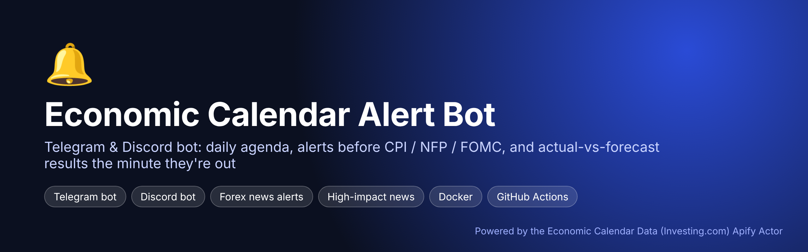
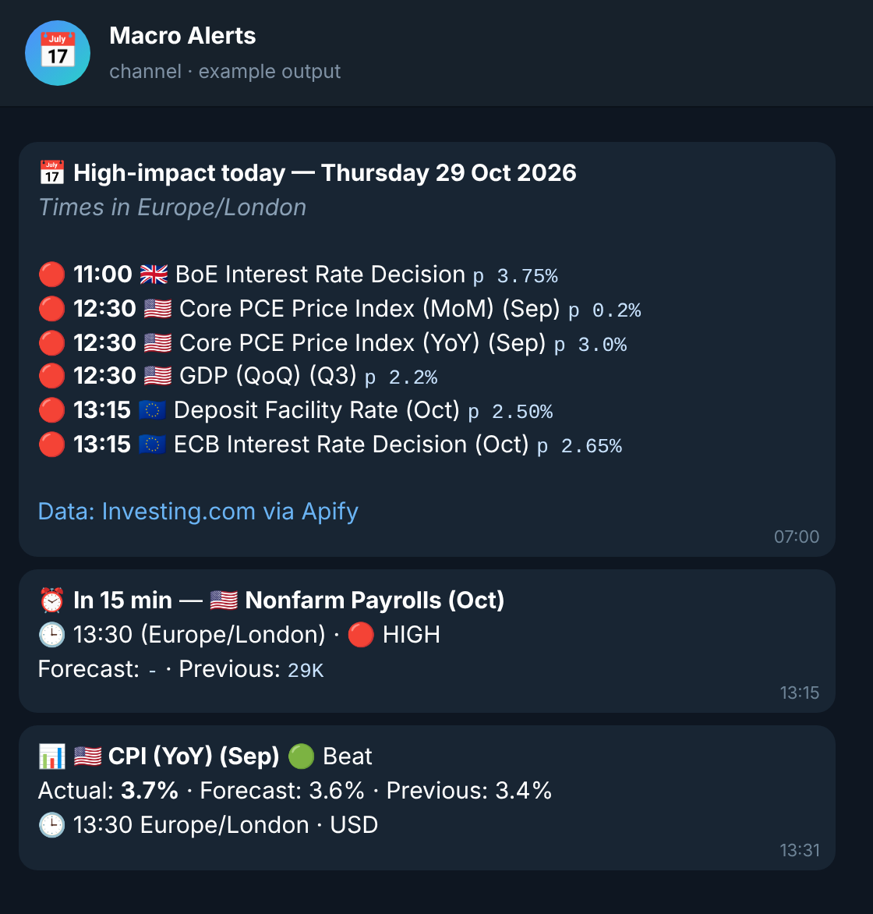
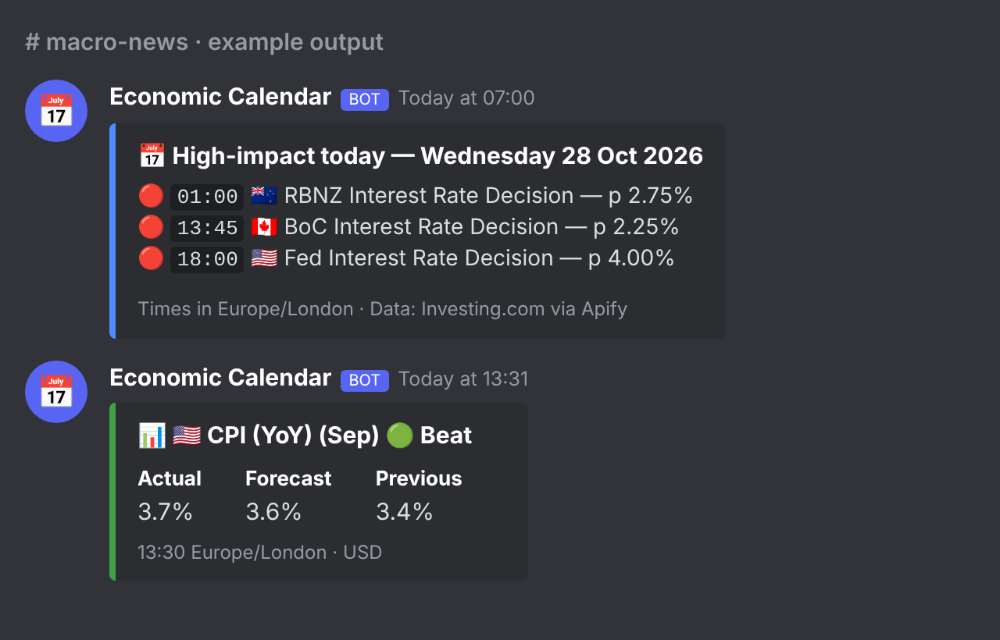

<p align="center"></p>

# Economic Calendar Alert Bot for Telegram & Discord (Forex News Alerts)

A ready-to-run **economic calendar Telegram bot** and **forex calendar Discord bot**. It posts:

1. 📅 a **daily agenda** of high-impact events (CPI, NFP, FOMC, GDP, PMIs, central bank decisions),
2. ⏰ a **reminder N minutes before** each release (with forecast and previous),
3. 📊 the **result as soon as it's out** — actual vs forecast, flagged 🟢 beat / 🔴 miss / ⚪ in line.

Events come from the Investing.com economic calendar via the **[Economic Calendar Data (Investing.com) Apify Actor](https://apify.com/pintostudio/economic-calendar-data-investing-com)** — 97 countries, filter by country and impact.

<table><tr>
<td></td>
<td></td>
</tr></table>

<sub>Example output generated from real Actor data (`python -m alertbot preview`).</sub>

## Features

- Telegram (channel, group or DM) and Discord (webhook) — use one or both
- Any countries: `united states`, `euro zone`, `united kingdom`, `japan`, `china`, … (97 supported)
- Impact filter: `high` (default), `medium`, `low` or `all`
- Messages in **your time zone** (`DISPLAY_TZ=America/New_York`, `Europe/London`, `Asia/Singapore`…)
- No duplicate alerts (small JSON state file), safe to restart
- Smart polling: hourly normally, every 2 min right after a release until the actual value appears
- Runs anywhere: Docker, a $5 VPS, Raspberry Pi, or **GitHub Actions** (daily agenda, free)

## Quick start (2 minutes, no tokens)

```bash
git clone https://github.com/BelNaruto/economic-calendar-alert-bot
cd economic-calendar-alert-bot
pip install -r requirements.txt

# preview the messages for US CPI day using the bundled real sample data
python -m alertbot preview --sample tests/sample-events.json \
  --now 2026-10-14T12:20:00Z --countries "united states" --tz America/New_York
```

## Go live

1. **Apify token** — create a free account and copy the token from [Console → Settings → Integrations](https://console.apify.com/settings/integrations). The bot calls the [Economic Calendar Actor](https://apify.com/pintostudio/economic-calendar-data-investing-com).
2. **Telegram** — talk to [@BotFather](https://t.me/BotFather) → `/newbot` → copy the token. Add the bot to your channel/group as admin. Chat id: `@yourchannel` or the numeric `-100…` id.
3. **Discord** — *Channel settings → Integrations → Webhooks → New webhook → Copy URL.*
4. Configure and run:

```bash
cp .env.example .env    # fill in the values
set -a; . ./.env; set +a
python -m alertbot agenda   # post today's agenda once
python -m alertbot run      # agenda + reminders + results, runs forever
```

### Docker

```bash
docker build -t econ-alert-bot .
docker run -d --restart unless-stopped --env-file .env -v econ-bot:/data econ-alert-bot
```

### GitHub Actions (free daily agenda)

Fork → *Settings → Secrets → Actions*: add `APIFY_TOKEN` plus `TELEGRAM_BOT_TOKEN` + `TELEGRAM_CHAT_ID` and/or `DISCORD_WEBHOOK_URL`. Optional repository *variables*: `COUNTRIES`, `IMPORTANCE`, `DISPLAY_TZ`. The workflow in `.github/workflows/daily-agenda.yml` posts every weekday at 06:00 UTC.

## Configuration

| Variable | Default | Description |
|---|---|---|
| `APIFY_TOKEN` | – | Apify API token (required for live data) |
| `TELEGRAM_BOT_TOKEN` / `TELEGRAM_CHAT_ID` | – | Telegram delivery |
| `DISCORD_WEBHOOK_URL` | – | Discord delivery |
| `COUNTRIES` | `united states,euro zone,united kingdom,japan` | Comma-separated country names |
| `IMPORTANCE` | `high` | `high`, `medium`, `low` or `all` |
| `REMIND_MINUTES` | `15` | Minutes before release to alert |
| `DISPLAY_TZ` | `UTC` | IANA time zone for messages |
| `AGENDA_TIME` | `07:00` | Local time for the daily agenda (`run` mode) |

## Cost

The Actor is pay-per-result (~$10 per 1,000 events). With the defaults (4 regions, high impact only, 3-day window) a refresh returns ~10–25 events, i.e. about **$0.10–$0.25 per refresh**; the bot refreshes hourly and every 2 minutes only for ~30 minutes after each release. Run the GitHub Actions daily agenda only if you want it nearly free.

## How it works

```
alertbot run ──(hourly / 2-min after releases)──► Apify API ──► Economic Calendar Data (Investing.com) Actor
     │                                                                 │ JSON events
     ├─ AlertEngine: reminder window? actual published? ◄──────────────┘
     └─ Telegram Bot API / Discord webhook
```

The Actor input used (see [input schema](https://apify.com/pintostudio/economic-calendar-data-investing-com/input-schema)):

```json
{ "countries": ["united states", "euro zone"], "importances": "high", "fromDate": "2026-10-14", "toDate": "2026-10-16" }
```

## Related projects

- [economic-calendar-ics](https://github.com/BelNaruto/economic-calendar-ics) — add the economic calendar to Google Calendar / Apple / Outlook
- [economic-calendar-dashboard](https://github.com/BelNaruto/economic-calendar-dashboard) — economic calendar this week, FOMC / CPI / NFP countdowns
- [economic-calendar-python](https://github.com/BelNaruto/economic-calendar-python) — Python API client, CLI, Excel export, news filter for backtests

## Disclaimer

Information only, not financial advice. MIT licensed.
